# VLM Trainer 5노드 — 학습 과정 한눈에 보기 (UI 개편용 자료)

> 이 문서는 UI 개편을 맡을 디자이너(Claude Design)에게 넘기는 자료입니다.
> **지금 화면이 어떻게 생겼고, 사용자가 어떤 순서로 무엇을 하는지**를 단계별 캡처와 함께 정리했습니다.
> 캡처는 실제 앱 화면입니다. 다만 학습을 실제로 돌려야 나오는 화면(실행 중·NG·검증 결과)은 예시 데이터로 채웠습니다.

---

## 1. 이 도구는 무엇을 하나요

**사진 · 질문 · 정답**을 넣으면 사진을 보고 답하는 AI 모델(VLM)을 학습시키고, 학습에 쓰지 않은 사진으로 검증까지 합니다.

쓰는 사람은 AI 전문가가 아니라 **기계·전자 전공의 제조 자동화 엔지니어**입니다. PLC, 설비 HMI, 인라인 검사, 양산 라인에는
익숙하지만 LoRA·토큰 같은 말은 모릅니다. 그래서 화면은 **생산 라인** 비유를 씁니다.

| 라인 비유 | 이 도구에서 |
|---|---|
| 워크 1개 | 데이터 1건 (사진 1장 + 질문 + 정답) |
| 공정 스테이션 | 노드(카드) 5개 |
| 인라인 검사 | 정답 형식 검사, 정답 노출 검사 |
| NG 배출 | 문제 있는 건은 학습에서 빼고 NG 표에 띄움 |
| 램프 | 카드 상태: 대기 · 진행 · 정상 · NG 있음 · 오류 |

---

## 2. 전체 흐름 (5단계)

```
[① 이미지] → [② 질문 형태] → [③ 정답 형태] → [④ 모델 학습] → [⑤ 검증]
  사진 넣기      질문 문장        정답 넣기         실행 누르기       결과 판정
```

예시 과제: **"공의 색상은?"** — 사진을 보고 공의 색상(검정색 / 파란색 / 흰색)을 답하게 학습합니다.

| 단계 | 사용자가 하는 일 | 걸리는 시간 |
|---|---|---|
| 0. 시작 | `line.bat` 더블클릭 → 새 폴더 이름 입력 | 10초 |
| 1. ① 이미지 | 사진 폴더 고르기, 질문 문장과 정답 항목 한 번에 입력 | 1분 |
| 2. ② 질문 형태 | 질문 문장 확인·수정 (`{image} 공의 색상은?`) | 10초 |
| 3. ③ 정답 형태 | 사진마다 정답 입력 (하위 폴더 이름으로 한 번에 채우기 가능) → `저장` | 사진 수에 따라 |
| 4. ④ 모델 학습 | 학습량(적게 · 보통 · 많게) 고르고 `실행` | 10초 + 학습 시간 |
| 5. 실행 중 | 카드 램프와 NG 표 보기, NG 건 고치기 | — |
| 6. ⑤ 검증 | `검증 결과`에서 모델 답을 보고 건마다 OK / NG 판정 | 건 수에 따라 |

---

## 3. 단계별 사용 시나리오

### 단계 0 — 시작: 새 프로젝트

`line.bat`을 더블클릭하고 새 폴더 경로를 적으면 빈 프로젝트가 열립니다. **① 이미지 카드가 골라진 채** 열리고,
오른쪽 설정 칸에 입력 방식(사진 폴더 / 표)이 보입니다. 아직 아무 데이터도 없으므로 실행할 수 없는 상태입니다.

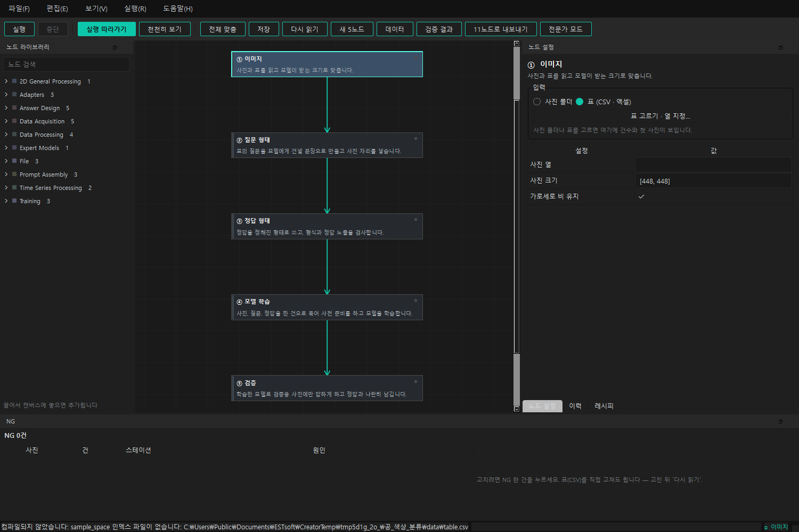

화면 구성:
- **가운데 캔버스**: 카드 5장이 위에서 아래로 한 줄. 카드끼리 화살표로 이어짐
- **오른쪽 "노드 설정"**: 고른 카드의 설정 패널
- **아래 "NG"**: 배출된 건 목록 (항상 보임)
- **왼쪽 "노드 라이브러리"**: 11노드 화면용. 5노드에서는 끌어다 놓아도 거부됨
- **위 툴바**: 실행 · 중단 · 실행 따라가기 · 천천히 보기 · 전체 맞춤 · 저장 · 다시 읽기 · 새 5노드 · 데이터 · 검증 결과 · 11노드로 내보내기 · 전문가 모드

### 단계 1 — ① 이미지: 사진 폴더 고르기

`사진 폴더`를 누르면 작은 창이 뜹니다. **폴더 · 질문 문장 · 정답 항목을 한 번에** 받습니다(셋이 다 있어야 실행 가능한 상태가 되기 때문).

- 폴더를 고르면 `사진 15장 · 하위 폴더 3개`처럼 바로 셉니다
- 하위 폴더(`검정색/`, `파란색/`, `흰색/`)가 있으면 그 이름들을 정답 항목의 허용값으로 미리 적어 줍니다
- 질문 문장의 `{image}`는 사진이 들어갈 자리입니다(맨 앞이나 맨 뒤만 가능)

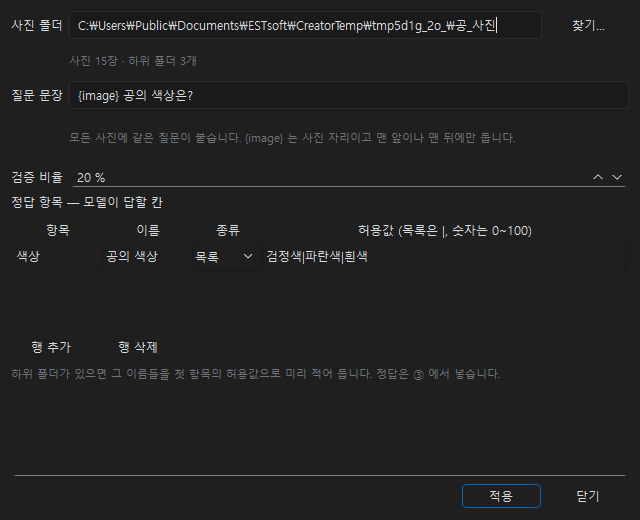

`적용`을 누르면 ① 패널이 이렇게 바뀝니다. **첫 사진의 원본과 "모델이 보는 크기"**를 나란히 보여 줍니다.
`사진 크기`를 바꾸면 오른쪽 그림이 학습 때와 똑같이 바뀝니다(작게 줄였을 때 결함이 뭉개지는지 확인하는 용도).

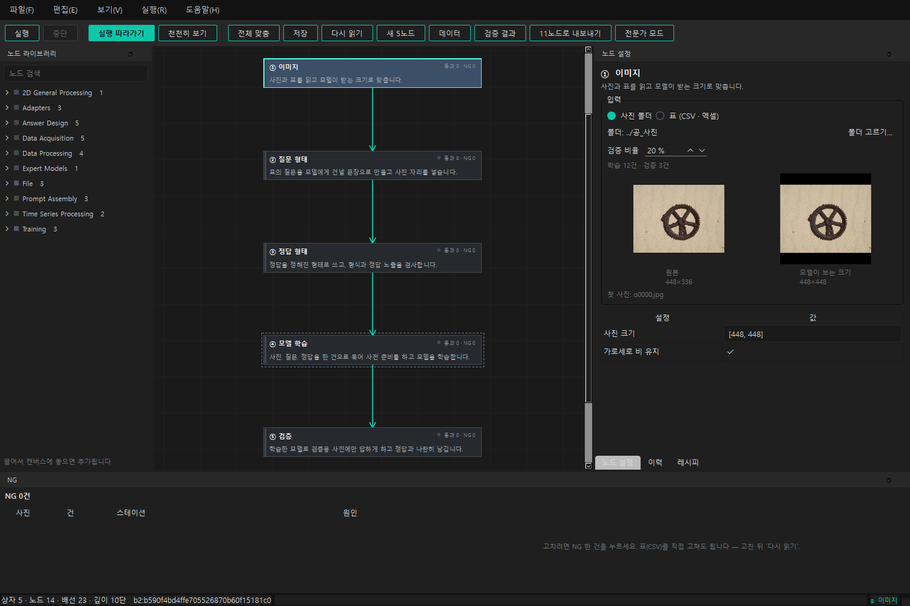

- 학습/검증 나누기: 무작위, 기본 검증 20% → `학습 12건 · 검증 3건`
- 폴더에 사진을 더 넣거나 빼면 다음에 열 때 자동으로 맞춰집니다(빠진 사진은 지우지 않고 "제외" 표시)

### 단계 2 — ② 질문 형태: 질문 문장

모든 사진에 붙는 질문 한 문장입니다. 아래에 **실제로 들어갈 질문**이 미리 보입니다.
`{image}`를 문장 가운데에 넣으면 이유를 보이고 거부합니다.

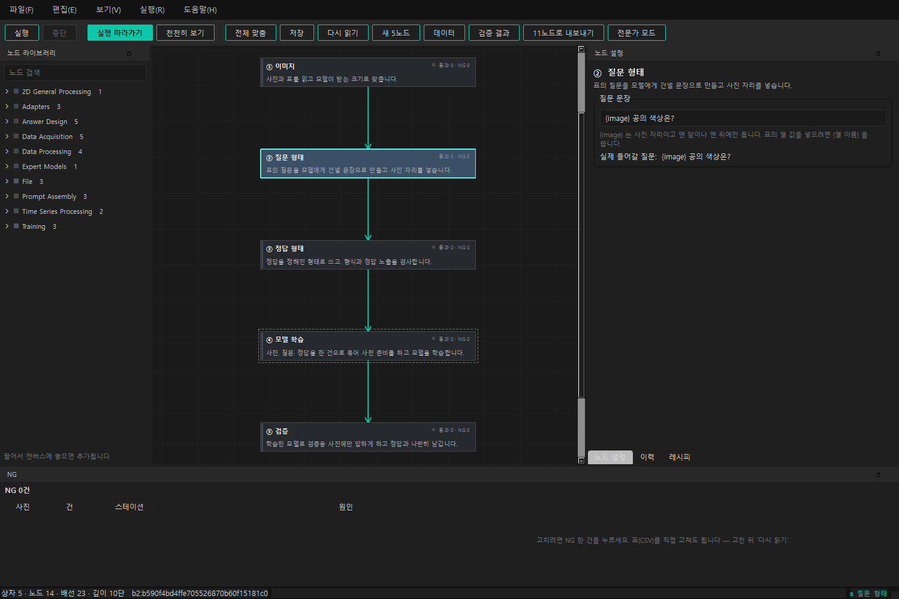

### 단계 3 — ③ 정답 형태: 정답 넣기

위쪽은 **정답 항목**(무엇을 답하게 할지: 항목 이름 · 종류 · 허용값), 아래쪽은 **건별 정답 표**입니다.
표는 `Index | 건 | Q. 질문 | A. 정답` 꼴이고, 줄을 고르면 그 사진이 크게 보입니다.

처음에는 정답 칸이 비어 있습니다:

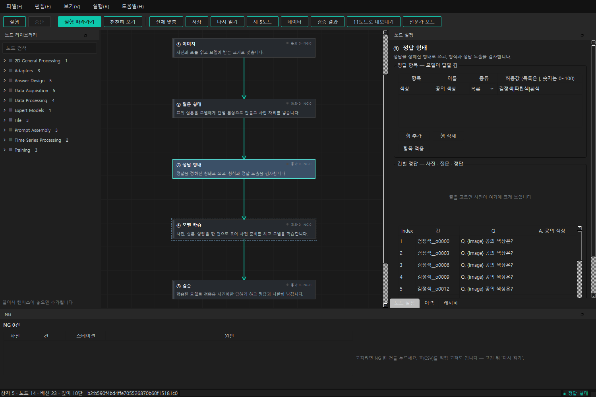

`하위 폴더 이름으로 채우기`를 누르면 빈 칸만 폴더 이름으로 채웁니다(이미 적은 값은 덮지 않음).
정답 칸을 직접 고쳐도 됩니다. **`저장`을 눌러야** 표 파일(`data.csv`)에 씁니다.
사진이 수백 장이면 `CSV로 열기`로 엑셀에서 입력합니다.

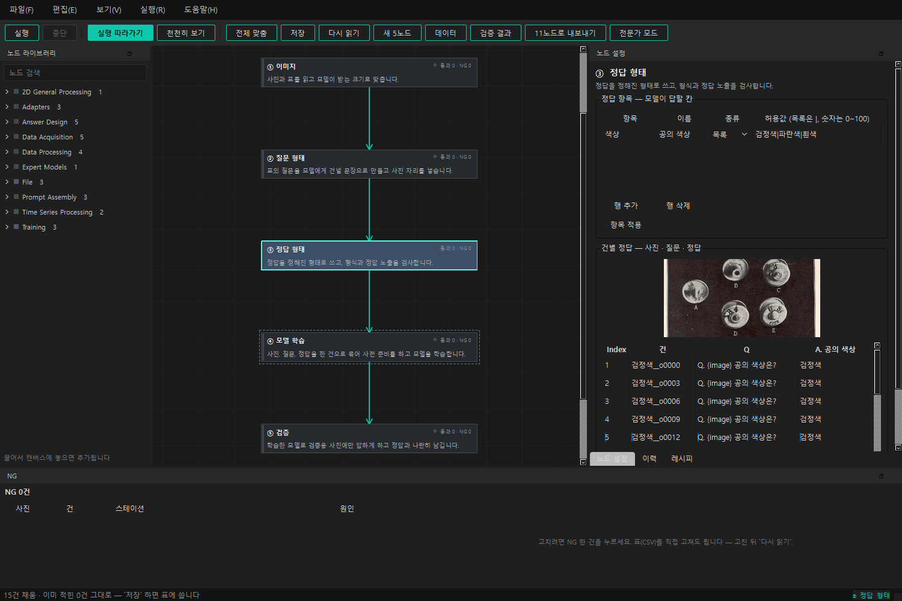

### 단계 4 — ④ 모델 학습: 학습량 고르고 실행

기본 모드에서는 **학습량 하나**(적게 · 보통 · 많게)만 보입니다. 고른 뒤 툴바의 `실행`을 누르면
준비 → 사전 준비 → 학습 → 검증을 끝까지 갑니다.

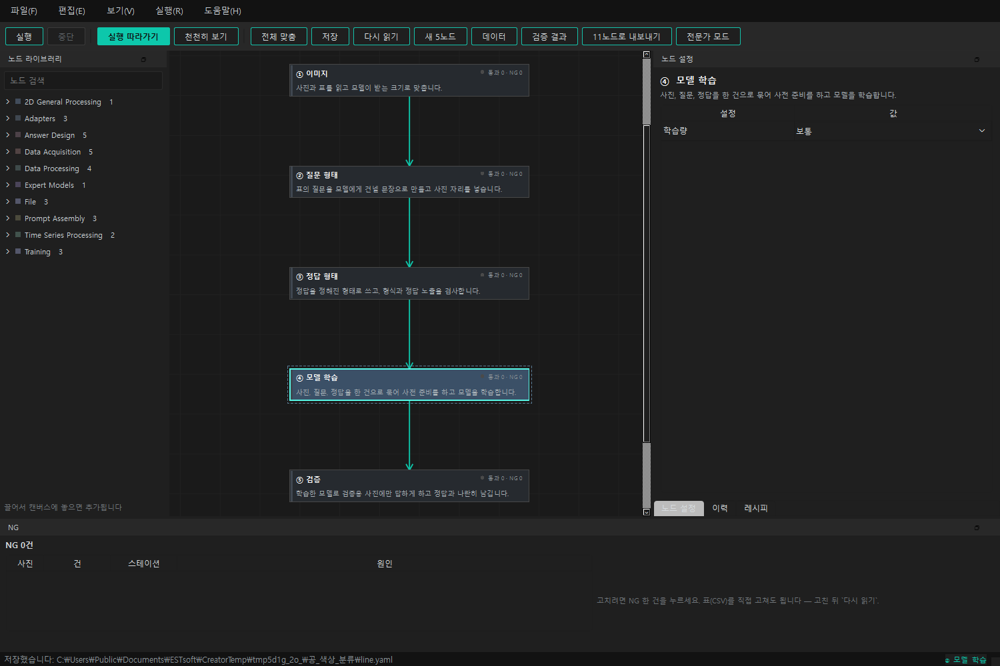

`전문가 모드`를 켜면 단계별 횟수 직접 입력과 안쪽 상자의 모든 값이 보입니다(창을 닫으면 꺼짐).

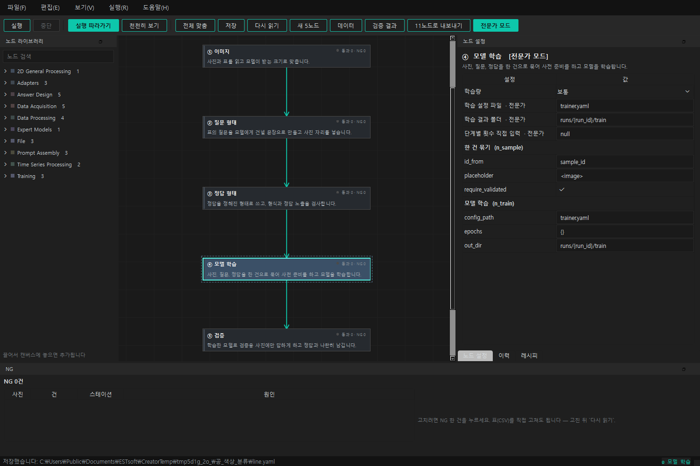

### 단계 5 — 실행 중: 램프와 NG

실행 중에는 카드마다 램프 색과 `통과 13 · NG 2` 같은 건수가 칠해집니다. ④는 `lora_ft · step 120 · loss 0.412`처럼
학습 진행을 보여 줍니다. 오른쪽에 진행 막대, 아래 상태줄에 경과·남은 시간이 나옵니다. 실행 중에는 설정을 고칠 수 없습니다.

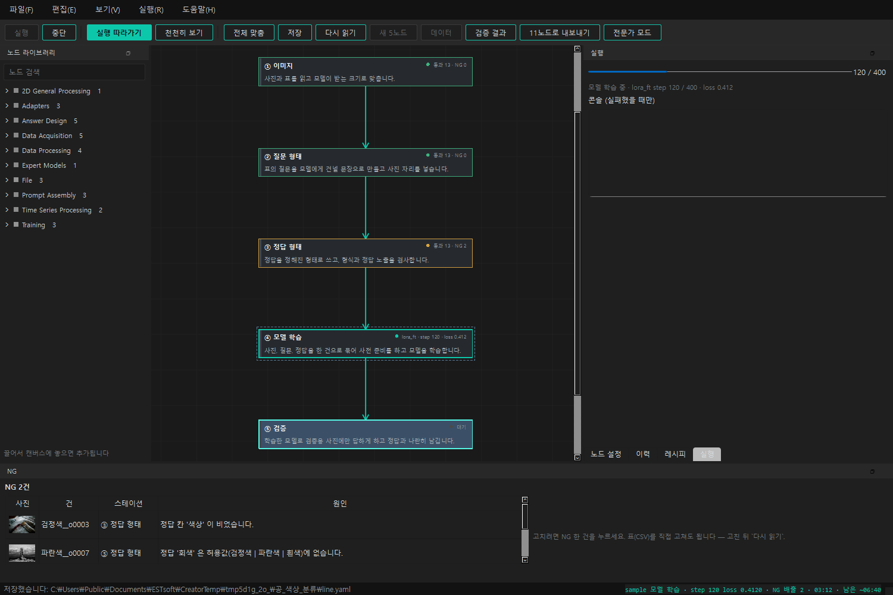

**NG 처리.** 아래 NG 표에서 한 건을 누르면 한 줄 요약(몇 번 스테이션인지 포함)과 `상세 보기`, 오른쪽에 `이 건 고치기`가 열립니다.
표의 그 행을 바로 고치고 `저장 후 다시 읽기`, 고칠 수 없는 건은 `이 건 제외`(행을 지우지 않고 x 표시).

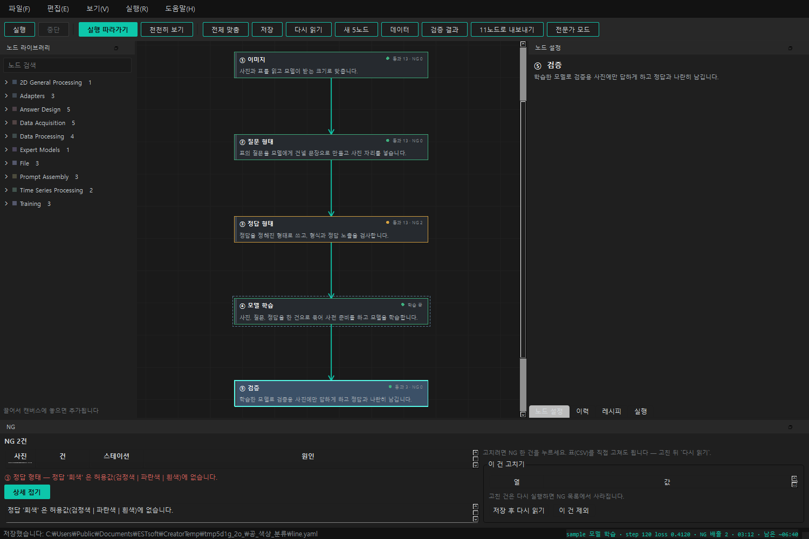

### 단계 6 — ⑤ 검증: 결과 판정

⑤ 카드의 기본 설정은 비어 있습니다(검증은 학습에 쓰지 않은 건에만 자동으로 합니다).

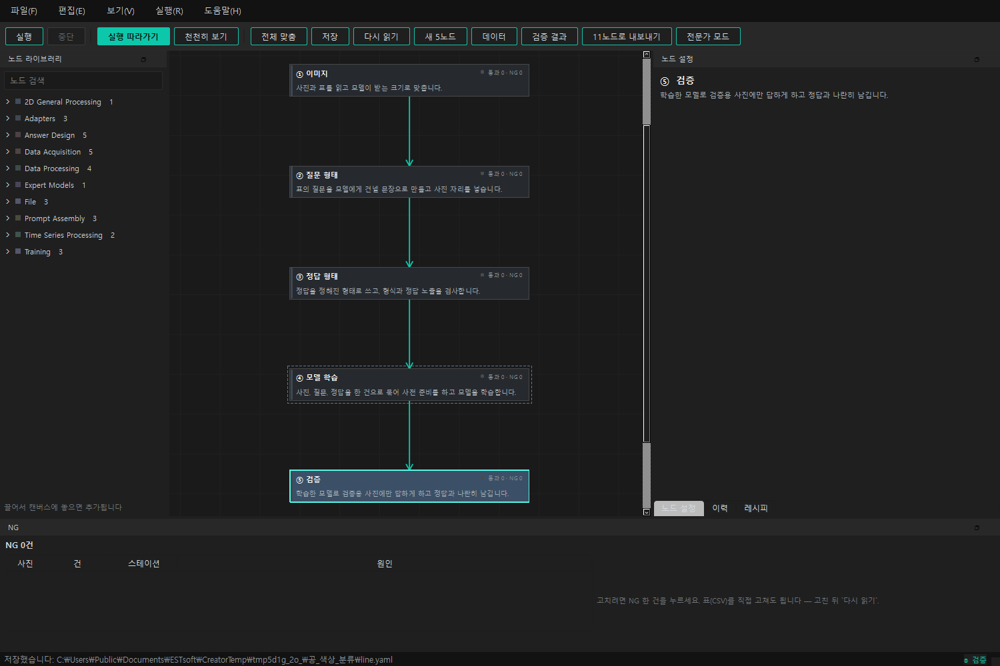

툴바의 `검증 결과`를 누르면 모델의 답을 정답과 나란히 봅니다. 항목마다 O/X가 붙지만 **참고용**이고,
최종 판정은 **사람이 건마다 OK / NG**를 누릅니다. 점수 합계는 내지 않습니다. 빈 답은 따로 표시됩니다.

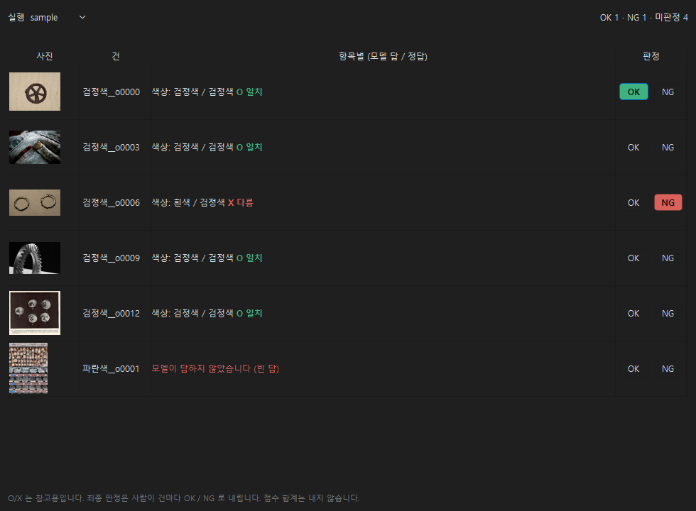

### 부록 — 안쪽 펼치기 (고급)

카드를 우클릭해 `펼치기`를 누르면 그 스테이션 안쪽의 실제 상자와 배선이 같은 캔버스 안에서 보입니다(읽기 전용).
아래는 ③ 정답 형태를 펼친 모습입니다(정답 형태 정하기 → 정답 만들기 → 정답 노출 검사).

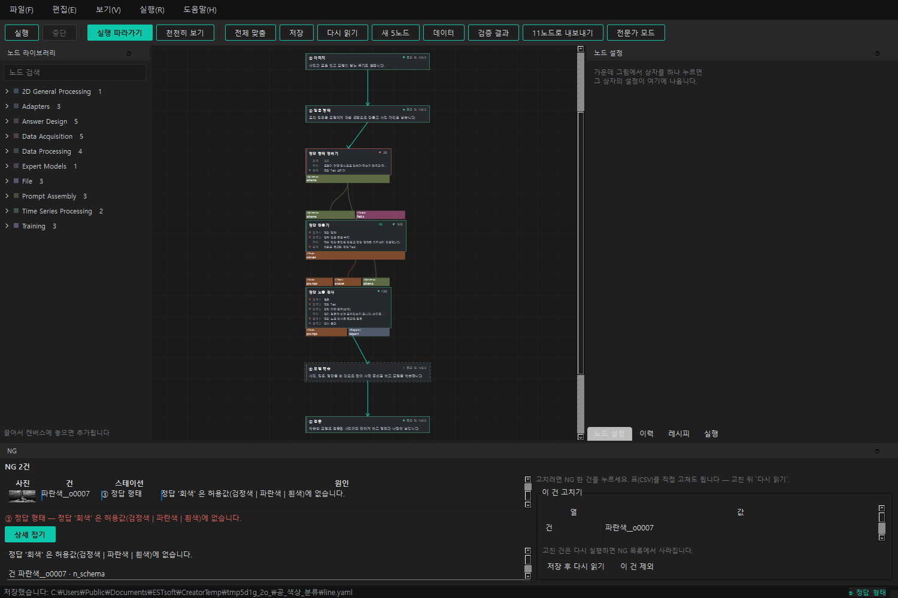

---

## 4. 디자인할 때 바꾸면 안 되는 것

이 도구의 존재 이유와 묶인 규칙입니다. 화면을 어떻게 바꾸든 아래는 유지돼야 합니다.

1. **검사는 끌 수 없습니다.** 정답 형식 검사와 정답 노출 검사(질문에 정답 낱말이 섞였는지)는 숨겨도 되지만 끄는 스위치는 없습니다.
   "경고만 하고 넘어가기" 같은 선택지도 만들지 않습니다.
2. **틀린 입력은 받지 않습니다.** 설정을 고치면 즉시 검증하고, 통과하지 못하면 원래 값으로 되돌린 뒤 이유를 보입니다.
   화면에만 남은 값이 있으면 안 됩니다.
3. **화면 전용 기능은 없습니다.** 화면에서 하는 모든 일은 터미널 명령(`vlmt …`)으로도 됩니다. 새 버튼을 그리면 같은 명령이 있어야 합니다.
4. **NG는 숨기지 않습니다.** 배출된 건의 수와 목록이 늘 보여야 합니다.
5. **오류 메시지는 네 가지를 담습니다**: 무엇이 어긋났는지 · 안 잡혔다면 언제 어디서 터졌을지 · 낭비될 시간 · 어떻게 고치는지.
   먼저 한 줄 요약(스테이션 번호 포함)을 보이고 나머지는 접어 둡니다. 말투는 합니다체입니다.
6. **용어는 현장어를 씁니다.** 프롬프트 → 질문 형태, 정답 스키마 → 정답 형태, epochs → 학습량, 파인튜닝 → 모델 학습 등.
   금지어 목록은 `vlm_trainer/ui/words.py`에 있고 테스트가 지킵니다.
7. **5노드는 한 줄 고정입니다.** 노드를 더하거나 배선을 바꾸는 것은 이 화면의 일이 아닙니다(`11노드로 내보내기`의 몫).
8. **입력 칸(①)은 나중에 바뀔 수 있습니다.** 센서 시계열 같은 다른 입력이 ① 자리에 들어올 수 있게 둡니다.

---

## 5. 지금 화면에서 보이는 문제 (캡처를 보며 정리)

개편 때 참고할 관찰입니다. 우선순위는 매기지 않았습니다.

- **툴바가 붐빕니다.** 버튼 12개가 한 줄에 같은 무게로 있습니다. 5노드 사용자에게 `실행 따라가기` · `천천히 보기`는 거의 의미가 없습니다.
- **왼쪽 노드 라이브러리가 자리만 차지합니다.** 5노드에서는 쓸 수 없는데(끌어다 놓으면 거부) 기본으로 펼쳐져 있습니다.
- **흐름(① → ⑤)이 안내되지 않습니다.** 지금 몇 번째 단계인지, 다음에 무엇을 해야 하는지 화면이 말해 주지 않습니다.
  새 프로젝트는 ①만 골라져 있을 뿐입니다.
- **카드가 정보에 비해 큽니다.** 카드 안 글자(설명 한 줄, 통과·NG 건수)가 매우 작습니다. 램프 점도 작아 멀리서 상태가 안 읽힙니다.
- **오른쪽 설정 칸이 좁고 깁니다.** ③ 정답 형태처럼 내용이 많으면 스크롤이 생기고, 건별 정답 표의 정답 칸이 잘립니다.
- **설정 칸의 아래쪽 표("설정 | 값")가 범용 모양입니다.** 위쪽 패널은 친절한데 아래 표는 개발자용 모양이라 섞여 보입니다.
- **⑤ 검증 패널이 비어 있습니다.** 정작 결과는 툴바의 `검증 결과` 대화상자에 있어 찾기 어렵습니다.
- **아래 NG 칸이 비좁습니다.** 상세를 펼치면 NG 표가 한두 줄로 줄고, `이 건 고치기` 표도 눌립니다. 비어 있을 때는 공간만 차지합니다.
- **상태줄에 긴 경로가 그대로 나옵니다.** 새 프로젝트를 열면 `컴파일되지 않았습니다: sample_space 인덱스 파일이 없습니다: C:\…` 같은 개발자 문장이 보입니다.
- **실행 중 오른쪽 "실행" 탭이 설정 칸을 가립니다.** 실행이 끝나도 탭이 남아 있습니다.
- **대화상자가 셋입니다**(폴더 고르기 · 데이터 · 검증 결과). 각각 다른 모양이고, 패널 흐름 밖으로 나갑니다.
- **판정 결과(⑤)와 NG(①~③)가 다른 곳에 있습니다.** 둘 다 "사람이 봐야 할 건"인데 한곳에서 보이지 않습니다.

---

## 6. 캡처 목록

| 파일 | 장면 | 데이터 |
|---|---|---|
| `captures/01_new_project.png` | 새 프로젝트, ① 골라진 상태 | 실제 |
| `captures/02_folder_dialog.png` | 사진 폴더 고르기 창 | 실제 (사진 15장, 하위 폴더 3개) |
| `captures/03_image_panel.png` | ① 원본 / 모델이 보는 크기 | 실제 |
| `captures/04_question_panel.png` | ② 질문 문장 | 실제 |
| `captures/05a_answer_panel_empty.png` | ③ 정답 입력 전 | 실제 |
| `captures/05b_answer_panel_filled.png` | ③ 하위 폴더 이름으로 채운 뒤, 한 줄 고름 | 실제 |
| `captures/06a_train_panel.png` | ④ 학습량 (기본 모드) | 실제 |
| `captures/06b_train_panel_expert.png` | ④ 전문가 모드 | 실제 |
| `captures/07_verify_panel.png` | ⑤ 검증 패널 | 실제 |
| `captures/08_running.png` | 실행 중 (④ 학습 진행, NG 2건) | 예시 진행 파일 |
| `captures/09_ng_fix.png` | NG 상세와 이 건 고치기 | 예시 진행 파일 |
| `captures/10_verdict.png` | 검증 결과 판정 (일치 · 다름 · 빈 답) | 예시 답 파일 |
| `captures/11_expand_inside.png` | ③ 안쪽 펼치기 | 실제 구조 + 예시 상태 |

사진은 저장소 예제(`solutions/vlm_open/data/open_parts/images`)의 공개 부품 사진을 색상 폴더에 나눠 담은 것이라,
사진 내용과 "공의 색상" 정답은 맞지 않습니다. 화면 배치를 보기 위한 자료입니다.

더 자세한 사용법은 [`docs/line-guide.md`](../line-guide.md)에 있습니다.
